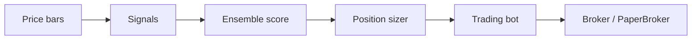

<p align="center">
  
</p>

<h1 align="center">AI Trading Bot</h1>

<p align="center">
  <strong>Broker-agnostic, AI/ML signal-driven algorithmic trading bot framework in Python.</strong><br>
  Blend indicators, machine-learning models, and sentiment into one signal — backtest it, then trade it.
</p>

<p align="center">
  <em>Built and maintained by <a href="https://viprasol.com">Viprasol Tech</a> — Fintech Experts. Full-Stack Builders.</em>
</p>

<p align="center">
  <a href="https://github.com/Viprasol-Tech/ai-trading-bot/actions/workflows/ci.yml"></a>
  <a href="LICENSE"></a>
  
  <a href="https://t.me/viprasol_help"></a>
  <a href="https://github.com/Viprasol-Tech/ai-trading-bot/stargazers"></a>
</p>

---

> ## ⚠️ Disclaimer
> This software is for **educational purposes only** and is **not financial advice**. Trading involves substantial risk, including the **total loss of capital**. Backtest results are **not** indicative of future performance. Always paper-trade first and comply with your broker's terms and your local laws. **Use at your own risk** — Viprasol Tech assumes no responsibility for your trading results.

---

## ✨ Features

- 🧠 **AI signal ensemble** — blend any number of signals (indicators, ML models, sentiment) into one normalised score.
- 🔌 **Broker-agnostic** — one `Broker` interface; a `PaperBroker` ships for risk-free runs.
- 📈 **Indicator signals included** — moving-average crossover and RSI, ready to extend.
- 🛡️ **Risk-aware sizing** — position sizing capped at a configurable fraction of equity.
- 🧪 **Backtester** — equity curve, total return, and max-drawdown metrics.
- 🖥️ **CLI** — `ai-trading-bot demo` runs the full pipeline on synthetic data.
- ⚙️ **Modern tooling** — ruff, mypy (strict), pytest, GitHub Actions CI.

## 🚀 Quickstart

```bash
git clone https://github.com/Viprasol-Tech/ai-trading-bot.git
cd ai-trading-bot
python -m pip install -e ".[dev]"

# Run the end-to-end demo backtest on synthetic data:
ai-trading-bot demo
```

## 🧩 Build your own signal

Any class that returns a score in `[-1, 1]` plugs straight into the ensemble:

```python
from ai_trading_bot.signals.base import Signal
from ai_trading_bot.signals.ensemble import SignalEnsemble
from ai_trading_bot.signals.indicators import MovingAverageCrossover, RSISignal
from ai_trading_bot.backtest.engine import run_backtest

class MyModel(Signal):
    name = "my_model"
    def evaluate(self, bars):
        # return your model's bullish/bearish score in [-1, 1]
        return 0.5

ensemble = SignalEnsemble([MovingAverageCrossover(10, 30), RSISignal(14), MyModel()],
                          weights=[1.0, 1.0, 2.0])
result = run_backtest("BTCUSDT", ensemble, bars)
print(result.total_return_pct, result.max_drawdown_pct)
```

## 🏗️ Architecture



## 🗺️ Roadmap

- [x] Signal ensemble + indicator signals
- [x] Paper broker + risk-aware sizing
- [x] Backtester with metrics
- [ ] Live broker/exchange adapters (ccxt, Alpaca)
- [ ] ML signal examples (sklearn, gradient boosting)
- [ ] Walk-forward optimisation & parameter search

## 🤝 Contributing

PRs welcome — see [CONTRIBUTING.md](CONTRIBUTING.md) and our [Code of Conduct](CODE_OF_CONDUCT.md).

## 📬 Contact — Viprasol Tech Private Limited

- 🌐 Website: [viprasol.com](https://viprasol.com)
- ✉️ Email: [support@viprasol.com](mailto:support@viprasol.com)
- 💬 Telegram: [t.me/viprasol_help](https://t.me/viprasol_help) · 📱 WhatsApp: +91 96336 52112
- 🐙 GitHub: [@Viprasol-Tech](https://github.com/Viprasol-Tech) · 💼 [LinkedIn](https://www.linkedin.com/in/viprasol/) · 𝕏 [@viprasol](https://twitter.com/viprasol)

> *Viprasol Tech — fintech software, algorithmic trading systems, MT4/MT5 bots, AI voice agents, and B2B SaaS. Need a custom build? [Get in touch](mailto:support@viprasol.com).*

## 📄 License

[MIT](LICENSE) © 2025 Viprasol Tech Private Limited
