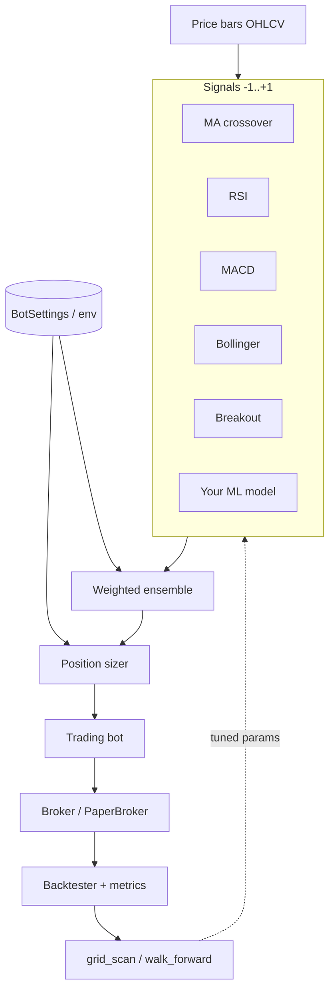

<p align="center">
  
</p>

<h1 align="center">AI Trading Bot</h1>

<p align="center">
  <strong>Broker-agnostic, AI/ML signal-driven algorithmic trading framework in Python.</strong><br>
  Blend indicators, ML models, and sentiment into one signal — backtest, grid-scan, walk-forward validate, then trade.
</p>

<p align="center">
  <em>Built and maintained by <a href="https://viprasol.com">Viprasol Tech</a> — Fintech Experts. Full-Stack Builders.</em>
</p>

<p align="center">
  <a href="https://github.com/Viprasol-Tech/ai-trading-bot/actions/workflows/ci.yml"></a>
  <a href="LICENSE"></a>
  
  
  
  
  
  <a href="https://t.me/viprasol_help"></a>
  <a href="https://github.com/Viprasol-Tech/ai-trading-bot/stargazers"></a>
</p>

---

> ## ⚠️ Disclaimer
> This software is for **educational purposes only** and is **not financial advice**. Trading involves substantial risk, including the **total loss of capital**. Backtest and walk-forward results are **not** indicative of future performance — they describe how a strategy *would have* behaved on the data you fed it, nothing more. Always paper-trade first, validate out-of-sample, and comply with your broker's terms and your local laws. **Use at your own risk** — Viprasol Tech assumes no responsibility for your trading results.

---

## ✨ Features

- 🧠 **AI signal ensemble** — blend any number of signals (indicators, ML models, sentiment) into one normalised score in `[-1, 1]`.
- 📊 **Five built-in signals** — MA crossover, RSI, **MACD**, **Bollinger Bands**, and **Donchian breakout**, all behind one tiny interface.
- 🔬 **Parameter optimisation** — exhaustive `grid_scan` ranked by any metric, plus rolling **walk-forward** validation with an efficiency score.
- 📈 **Rich backtest metrics** — total return, CAGR, annualised volatility, **Sharpe**, **Sortino**, max drawdown, and realised **win rate**.
- ⚙️ **Typed config** — a pydantic `BotSettings` describing the whole run, overridable from the environment (`ATB_*`) or a `.env` file.
- 🔌 **Broker-agnostic** — one `Broker` interface; a trade-counting `PaperBroker` ships for risk-free runs.
- 🛡️ **Risk-aware sizing** — position sizing capped at a configurable fraction of equity, gated by an entry threshold.
- 🖥️ **Rich CLI** — `demo`, `backtest`, `scan`, and `walkforward` subcommands rendering tidy tables.
- 🧪 **Battle-tested** — 46 tests, `ruff`, `mypy --strict`, and GitHub Actions CI.

## 🚀 Quickstart

```bash
git clone https://github.com/Viprasol-Tech/ai-trading-bot.git
cd ai-trading-bot
python -m pip install -e ".[dev]"

# End-to-end demo backtest on synthetic data:
ai-trading-bot demo

# Backtest a single signal:
ai-trading-bot backtest --signal macd

# Grid-scan MA-crossover windows, ranked by Sharpe:
ai-trading-bot scan --metric sharpe --top 5

# Rolling in-sample/out-of-sample validation:
ai-trading-bot walkforward --folds 4
```

## 🧩 Usage

Any class that returns a score in `[-1, 1]` plugs straight into the ensemble, and
the optimiser will tune anything you can build from a parameter dict:

```python
from collections.abc import Mapping

from ai_trading_bot.backtest.engine import run_backtest
from ai_trading_bot.optimize.scan import grid_scan, walk_forward
from ai_trading_bot.signals.base import Signal
from ai_trading_bot.signals.ensemble import SignalEnsemble
from ai_trading_bot.signals.indicators import MACDSignal, MovingAverageCrossover, RSISignal


# 1) Blend signals (add your own ML model the same way) and backtest.
class MyModel(Signal):
    name = "my_model"

    def evaluate(self, bars):
        return 0.5  # your model's bullish/bearish score in [-1, 1]


ensemble = SignalEnsemble(
    [MovingAverageCrossover(10, 30), RSISignal(14), MACDSignal(12, 26, 9), MyModel()],
    weights=[1.0, 1.0, 1.0, 2.0],
)
result = run_backtest("BTCUSDT", ensemble, bars)
print(result.as_dict())  # total_return_pct, sharpe, sortino, max_drawdown_pct, ...


# 2) Grid-scan a parameter space, ranked best-first by a metric.
def build_ma(p: Mapping[str, float]) -> Signal:
    return MovingAverageCrossover(int(p["fast"]), int(p["slow"]))


ranked = grid_scan("BTCUSDT", build_ma, bars, {"fast": [5, 10], "slow": [30, 40]}, metric="sharpe")
print(ranked[0].params, ranked[0].score)

# 3) Walk-forward validate so the result is honest (out-of-sample only).
wf = walk_forward("BTCUSDT", build_ma, bars, {"fast": [5, 10], "slow": [30, 40]}, folds=4)
print(wf.avg_out_of_sample, wf.efficiency)
```

A runnable version lives in [`examples/quickstart.py`](examples/quickstart.py):

```bash
PYTHONPATH=src python examples/quickstart.py
```

## 🏗️ Architecture



## 🧰 Feature & API Reference

| Area | Public API | What it does |
|------|------------|--------------|
| Signals | `MovingAverageCrossover`, `RSISignal`, `MACDSignal`, `BollingerBandsSignal`, `BreakoutSignal` | Indicator signals emitting a score in `[-1, 1]` |
| Ensemble | `SignalEnsemble(signals, weights)` | Weighted blend of any signals (incl. ML models) |
| Config | `BotSettings`, `SignalConfig`, `SignalKind` | Typed, env-overridable run configuration (pydantic) |
| Risk | `PositionSizer`, `RiskConfig` | Score → target quantity, capped by equity fraction |
| Execution | `Broker`, `PaperBroker` | Pluggable venue; paper broker tracks realised trades |
| Backtest | `run_backtest(...)`, `BacktestResult` | Equity curve + return / Sharpe / Sortino / drawdown / win rate |
| Optimise | `grid_scan(...)`, `walk_forward(...)` | Ranked grid search and rolling out-of-sample validation |
| CLI | `demo`, `backtest`, `scan`, `walkforward`, `version` | Run everything from the terminal |

## 🗺️ Roadmap

- [x] Signal ensemble + indicator signals (MA, RSI)
- [x] Paper broker + risk-aware sizing
- [x] Backtester with metrics
- [x] MACD, Bollinger Bands & breakout signals
- [x] Rich metrics: CAGR, Sharpe, Sortino, win rate
- [x] Grid scan + walk-forward optimisation
- [x] Typed pydantic configuration + CLI subcommands
- [ ] Live broker/exchange adapters (ccxt, Alpaca)
- [ ] ML signal examples (sklearn, gradient boosting)
- [ ] Multi-symbol portfolio backtests

## ❓ FAQ

**Is this connected to a real exchange?**
Not out of the box — it ships a `PaperBroker` for safe, deterministic runs. Implement the `Broker` interface to connect any venue.

**Where is the "AI"?**
In the ensemble layer: every signal is normalised to `[-1, 1]`, so an ML model is just another `Signal`. Blend it with indicators and learn the weights.

**Are the walk-forward numbers trustworthy?**
Walk-forward measures parameters *chosen without seeing* the evaluation window, which is far more honest than a single in-sample backtest — but it is still historical. See the disclaimer.

**Can I tune my own signal?**
Yes. Provide a builder `(params) -> Signal` and hand it to `grid_scan` / `walk_forward` with a parameter grid.

## 🤝 Contributing

PRs welcome — see [CONTRIBUTING.md](CONTRIBUTING.md) and our [Code of Conduct](CODE_OF_CONDUCT.md). Run `ruff check . && ruff format . && mypy src && pytest` before opening a PR.

## Contact — Viprasol Tech Private Limited

- Website: [viprasol.com](https://viprasol.com)
- Email: [support@viprasol.com](mailto:support@viprasol.com)
- Telegram: [t.me/viprasol_help](https://t.me/viprasol_help) | WhatsApp: +91 96336 52112
- GitHub: [@Viprasol-Tech](https://github.com/Viprasol-Tech) | [LinkedIn](https://www.linkedin.com/in/viprasol/) | X [@viprasol](https://twitter.com/viprasol)

## License

[MIT](LICENSE) (c) 2025 Viprasol Tech Private Limited
